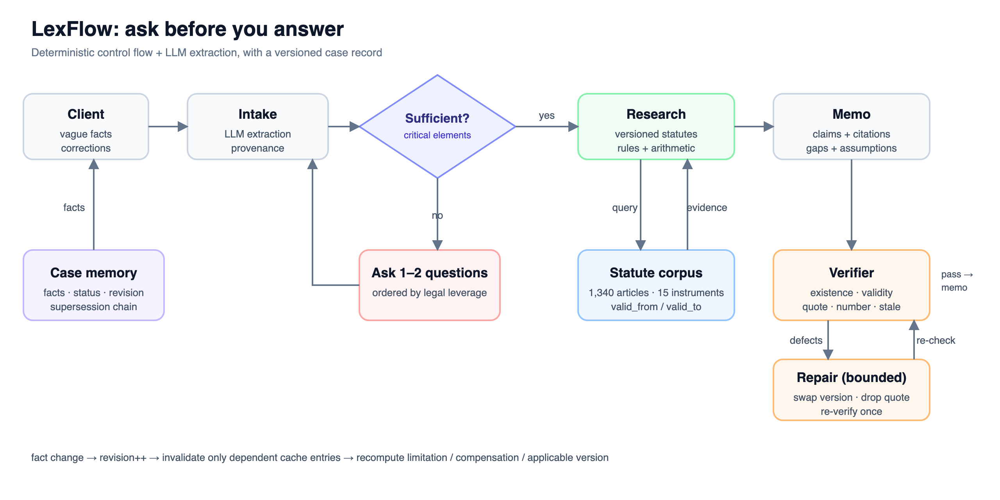
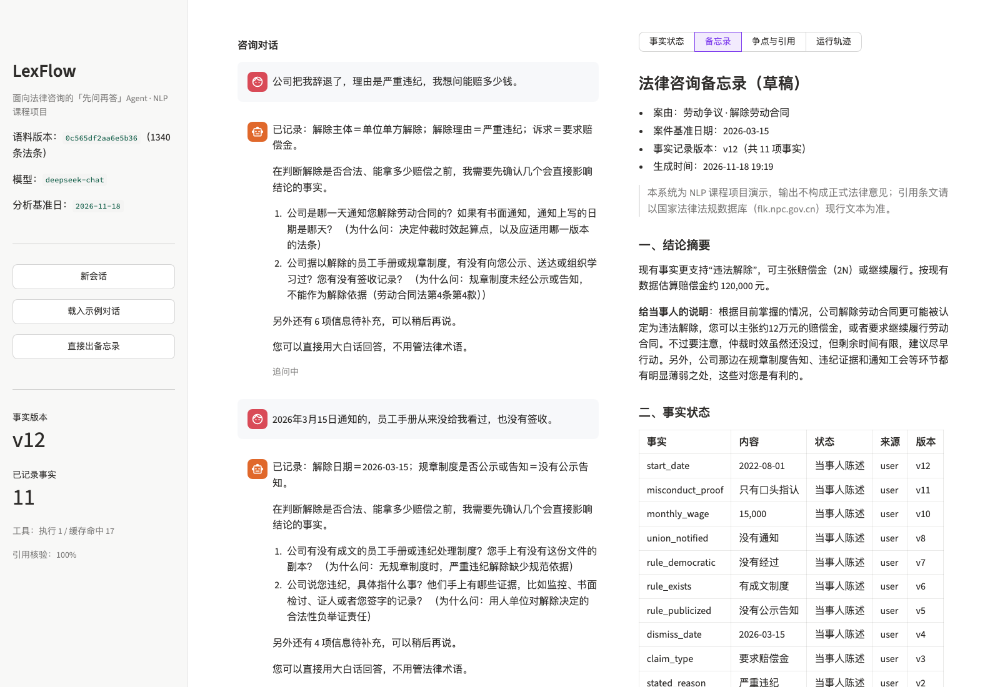
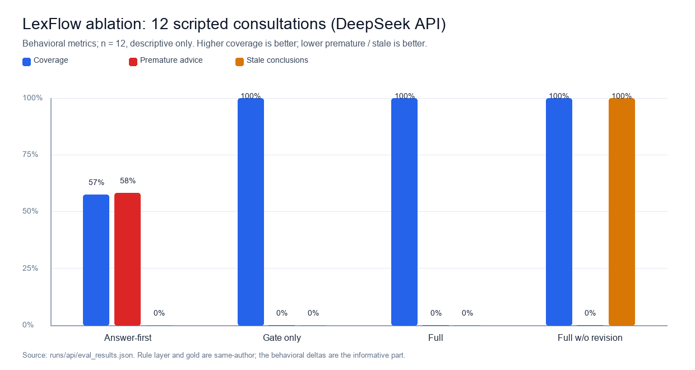

# LexFlow: Ask Before You Answer

**A sufficiency-gated legal consultation agent with versioned case memory**

NLP course project report (draft)

---

## Abstract

Legal question answering systems usually assume that the facts are already complete and stable. Real consultations are neither. A client says "my company fired me" and omits the dismissal date, whether the handbook was publicised, and whether the union was notified; each of these facts can change the conclusion from a 2N unlawful-dismissal claim to a lawful no-compensation dismissal, or to a claim already barred by the one-year arbitration limitation period. We present LexFlow, a consultation agent that (i) decides whether the facts it has are sufficient before answering, (ii) retrieves the statute version in force on the relevant date, (iii) writes an auditable memorandum with a fact-status table and explicit gaps, and (iv) revises only the conclusions that depend on a corrected fact. On 12 scripted consultations covering labour dismissal and traffic-accident injury, gating raises critical-fact coverage from 57.5% to 100% and reduces premature advice from 58.3% to 0%; versioned memory reduces stale conclusions after a correction from 100% to 0%. The full four-condition ablation over 12 cases costs about RMB 0.17 with DeepSeek's official API. We do not claim general legal capability; the evaluation is a controlled behavioural protocol, not a new benchmark.

---

## 1. Introduction

A legal consultation is not a retrieval problem with a natural-language interface. It is a sequence of decisions: which facts matter, which are missing, which version of the law applies, what can be concluded now, and what must wait for evidence. A search assistant answers the first message; a consultation agent has to decide whether the first message is answerable at all.

This project asks three questions:

- **RQ1.** Does element-based sufficiency gating increase critical-fact coverage and reduce premature advice, compared with an answer-first pipeline?
- **RQ2.** Does versioned case memory with dependency-aware invalidation reduce stale conclusions after a fact correction?
- **RQ3.** Can mechanical claim-to-evidence verification detect missing, outdated, mismatched, or numerically inconsistent citations without flagging clean output?

The scope is deliberately narrow: two claim types — unlawful dismissal in labour disputes, and personal injury from traffic accidents — in Chinese law. Narrow scope makes the legal rules tractable, the gold answers checkable, and the failure modes observable. The contribution is the mechanism and its measurement, not a new base model or a new benchmark.

---

## 2. Related work

**Consultation benchmarks.** LeCoDe (ACL 2026) collects 3,696 real consultation dialogues and shows that strong models elicit only about 36% of annotated key facts before giving advice [1]. DLawBench (2026) pairs 461 Chinese and U.S. cases with client-belief and court-record views, four client personas, and expert inquiry/resolution rubrics; its best model reaches 0.562 on consultation-grounded legal reasoning and exhibits legal sycophancy [2]. LexRAG (SIGIR 2025) evaluates multi-turn retrieval of legal articles [7].

**Hallucination and verification.** LexAgentHallu (EMNLP 2026) profiles hallucinations along agent trajectories and reports a right-answer-wrong-reason effect [3]. Harvey's Legal Agent Benchmark and its independent reimplementation add hallucination checks and a three-judge rubric panel [6, 9]. These works motivate mechanical checks on citations and numbers rather than fluency judgments.

**Temporal validity.** LegalSearch-R1 (NLLP 2026) shows that legal agents are temporally biased toward their training cutoff and rarely encode temporal constraints in queries; temporal-indexed RL improves consistency substantially [4]. We do not train; we make the applicable version a property of retrieval and verification.

**Environments and tools.** LegalAgentBench (ACL 2025) provides 300 Chinese tasks and 37 tools [8]; LegalWorld (EMNLP 2026) models civil litigation as a five-stage causal state chain [5]. LexFlow is much smaller: an explicit state machine, a local statute corpus, and two claim schemas.

The gap we target is narrow but real: existing consultation benchmarks evaluate a consultation in which the fact pattern is fixed. None measures whether a conclusion is revised when the client corrects a fact, and none treats the statute version as part of the agent's state.

---

## 3. System

### 3.1 Overview

The control flow is deterministic: intake → sufficiency gate → research → memo → verify → revise. The model is used for fact extraction and for a short plain-language explanation; it does not choose citations, compute amounts, or decide when to stop asking.

### 3.2 Element schemas and the gate

`data/elements.json` defines, for each claim type, the fields that can change the outcome, their type, a client-facing question, the legal reason for asking, and the statutory basis. Conditional criticality is explicit: questions about the publicity of the handbook are critical only when the employer relies on serious misconduct; the claimant's urban/rural residence is critical for disability or death compensation only before 2022-05-01.

The gate is a schema operation. The agent answers only when every critical field is present at day-level precision, or when the question budget is exhausted; in the latter case the memorandum states the gaps instead of filling them. Questions are ordered by legal leverage — limitation first, then the ground for dismissal, then computation — at most two per turn and fourteen per session.

### 3.3 Version-aware corpus and deterministic rules

`tools/build_corpus.py` builds an article-level corpus from a public markdown collection of Chinese statutes [10]: 15 instruments and 1,340 articles, each with `valid_from`, `valid_to`, source path, and a manual note where the text is a consolidated version. Retrieval is dependency-free BM25 over character bigrams with a small legal synonym table; results can be restricted to the version in force on the case date, and the agent can locate the predecessor or successor of an article.

The rule layer encodes the parts of law that are definitional or arithmetic:

- labour arbitration limitation: 60 days before 2008-05-01 (Labour Law art. 82), one year afterwards (Mediation and Arbitration Act art. 27);
- tort limitation: one year before 2017-10-01 (General Principles of Civil Law art. 136), three years afterwards (General Principles of Civil Law 2017 art. 188, Civil Code art. 188);
- compensation: 0 under a lawful Article 39 dismissal, N under Articles 40/41/46, 2N under Article 87, with the six-month rounding rule and an optional one-month payment in lieu of notice;
- damages standards: the 2003, 2020 and 2022 interpretations of personal-injury compensation, including the 2022 unification of urban and rural standards;
- tort liability: the Tort Liability Law before 2021-01-01, the Civil Code afterwards.

### 3.4 Versioned memory and cache

Facts are stored with provenance (`user-stated`, `documentary`, `verified`, `unknown`), a revision number, and a superseded chain. A new statement does not silently overwrite a documentary record; a conflict is surfaced and the user is asked to check the original. Each change increments the case revision and invalidates only the cache entries whose declared fact dependencies intersect the changed keys. Public statute lookups have no fact dependencies and remain reusable.

### 3.5 Verification and bounded repair

Every conclusion carries article IDs, a quoted span, dependent facts, and the case revision used. The verifier emits typed defects: `MISSING_SOURCE`, `UNKNOWN_SOURCE`, `VERSION_NOT_IN_FORCE`, `QUOTE_MISMATCH`, `SUPERSEDED_FACT`, `MISSING_DEPENDENCY`, `UNVERIFIED_NUMBER`. Repair is bounded to one cycle: replace a citation with the version in force, drop a mismatched quote, or drop an unknown source. Unresolved defects remain visible in the memorandum.

### 3.6 Interface

A Streamlit interface shows the conversation on the left and, on the right, the live fact table, the memorandum, the issue-by-issue citations, and the execution trace.

---

## 4. Evaluation

### 4.1 Controlled consultation protocol

We construct 12 scripted cases (7 labour, 5 tort). Each case contains an opening message, a hidden fact sheet, a set of critical facts, hand-computed gold conclusions, and — for two cases — a correction delivered after the first memorandum. A scripted client answers only the fields it is asked about and says "I don't know" otherwise. This removes human annotation from the loop and makes every run reproducible.

The labour cases cover handbook not publicised, handbook publicised, incompetence without training, compliant incompetence dismissal, negotiated termination, an expired limitation period, and a corrected dismissal date. The tort cases cover accidents on both sides of the 2022-05-01 interpretation boundary, a 2020 accident governed by the 2003 interpretation, and a corrected accident date that crosses the boundary.

### 4.2 Conditions and metrics

Four conditions use the same model, tools, and budget: `answer_first` (no gate, no verification), `gate_only`, `full` (gate + verification + revision), and `full_no_revision` (the same system, deliberately reusing the analysis produced before the correction).

Metrics are: fact coverage at memorandum time; inquiry recall over facts not volunteered in the opening; number of questions; premature-advice rate; citation support rate; agreement with hand-computed gold on illegality, amount, limitation deadline, and interpretation version; and stale-conclusion rate after correction.

Because the rule layer and the gold answers are authored by the same person, high agreement on illegality and amount is a **consistency** result, not evidence of legal capability. The informative comparisons are the behavioural ones: coverage, premature advice, citation support, and stale conclusions.

### 4.3 Verification probe and cache replay

A guardrail that never fires is not evidence. We inject five defect types into clean analyses: an unknown article, a version not in force, a fabricated quote, a superseded dependency, and an altered amount. We also replay a turn with no new facts with the cache on and off, and correct one fact to observe which entries are invalidated.

### 4.4 Human blind review (to be completed)

Two reviewers score ten memoranda, blinded to condition, on traceability, separation of facts and assumptions, honesty about gaps, temporal validity, and readability. The review sheet is `docs/memo_review_sheet.md`. This section will be filled before submission; the automatic checks below are not a substitute.

---

## 5. Results

### 5.1 Main ablation

Model: `deepseek-chat` (DeepSeek V4-Flash alias, non-thinking mode), temperature 0, `max_tokens=1600`. Twelve cases × four conditions. Total consumption: 149,059 input and 10,987 output tokens; estimated cost **RMB 0.171** at the October 2026 official price (input 1 RMB/M, output 2 RMB/M, cache miss).

| Condition | Coverage | Inquiry recall | Questions | Premature | Citation support | Illegality | Amount | Limitation | Version | Stale |
|---|---:|---:|---:|---:|---:|---:|---:|---:|---:|---:|
| answer_first | 57.5% | 41.7% | 0.0 | 58.3% | 83.3% | 85.7% | 0% | 50.0% | 100% | 0% |
| gate_only | 100% | 100% | 4.4 | 0% | 100% | 100% | 100% | 100% | 100% | 0% |
| full | 100% | 100% | 4.4 | 0% | 100% | 100% | 100% | 100% | 100% | 0% |
| full_no_revision | 100% | 100% | 4.4 | 0% | 92.2% | 100% | 85.7% | 83.3% | 80% | 100% |

Three observations:

1. **Gating is the main driver.** Without it, the agent answers from whatever the opening contains: coverage 57.5%, premature advice 58.3%, and the compensation amount is never computable. With it, coverage reaches 100% and premature advice disappears.
2. **Verification does not change the normal path.** `gate_only` and `full` are identical because the rule layer produces valid citations; the verifier is a guardrail, not a quality booster. Its value is measured by injection (below).
3. **Memory is not revision.** `full_no_revision` has the same coverage but keeps the pre-correction analysis: 100% stale conclusions, 85.7% amount accuracy, 83.3% limitation accuracy, 80% version accuracy. Versioning is what turns memory into an update.

### 5.2 Verifier probe

| Defect | Injections | Detected | Rate |
|---|---:|---:|---:|
| `UNKNOWN_SOURCE` | 12 | 12 | 100% |
| `VERSION_NOT_IN_FORCE` | 12 | 12 | 100% |
| `QUOTE_MISMATCH` | 12 | 12 | 100% |
| `SUPERSEDED_FACT` | 12 | 12 | 100% |
| `UNVERIFIED_NUMBER` | 7 | 7 | 100% |

Clean analyses: 0 false positives across 12 cases.

### 5.3 Cache replay

| Scenario | Tools executed | Cache hits |
|---|---:|---:|
| Cache on, replay with no new facts | 0 | 18 |
| Cache off, same replay | 18 | 0 |
| After correcting one date | 8 | 10 |

Correcting the dismissal date invalidates one dependent cache entry; the other ten calls (public statute lookups) remain valid. This is the intended granularity: not a session-wide flush, and not a stale reuse.

---

## 6. Error analysis

**A real bug found by the API run.** The first API pass failed L06's limitation check: the client said "2024年1月", the model normalised it to `2024-01-01`, and the gate treated it as a day-precision fact, so the deadline became 2025-01-01 instead of 2025-01-05. The fix was to recover month precision from the original text and ask for the exact day. This is a useful illustration of the project's thesis: the dangerous error is not a wrong sentence, but a wrong state that later reasoning treats as certain.

**Same-author gold.** The rule layer and the gold answers were written by the same person. The 100% agreement on illegality, amount, limitation, and version is therefore a consistency check, not a capability result. The behavioural deltas (coverage, premature advice, stale conclusions) are less exposed to this criticism because they are defined by the protocol, not by the rules.

**Verifier blind spots.** It cannot detect a legally wrong but valid-version citation, a gap in argument, or a non-comparable precedent. It checks existence, validity, quote match, number consistency, and fact freshness; nothing more.

**LLM explanation is unchecked.** The plain-language paragraph is generated from the finding set, but the verifier does not parse it. It is instructed not to add facts, amounts, or dates; a stricter version would treat it as a claim set and verify it too.

**Scripted client too cooperative.** Real clients are emotional, inconsistent, and sometimes misleading. The protocol does not test sycophancy or adversarial disclosure; DLawBench's four personas are the natural next step.

---

## 7. Limitations

1. Two claim types only; the system is not a general legal assistant.
2. Limitation start dates are simplified to the dismissal/accident date; in practice they may be the date of service, diagnosis, or disability assessment.
3. The three-times local average wage cap and the twelve-year cap are documented but not computed; local statistics are not integrated.
4. Tort damages are not computed: disability grade, medical receipts, and local income data are required.
5. The union-notification rule assumes an established union; the conclusion says so.
6. No case-law retrieval; the corpus contains statutes and judicial interpretations, not judgments.
7. Twelve cases and a scripted client; no statistical significance is claimed.
8. The public benchmark comparison is qualitative; DLawBench and LeCoDe are design references, not reproduced results.

---

## 8. Conclusion and future work

LexFlow shows that a small, deterministic legal layer plus a language model can make a consultation agent's uncertainty inspectable: it asks before answering, cites the version in force, and revises when the facts change. The next steps are a third claim type, four client personas, an embedding retriever as a controlled comparison, and a human blind review of ten memoranda. The longer-term direction is to use the element schema and the verifier as a source of verifiable reward signals for post-training, which is cheaper and more auditable than annotating free-text legal opinions.

---

## References

[1] W. Yuan et al. LeCoDe: A Benchmark Dataset for Interactive Legal Consultation Dialogue Evaluation. ACL 2026. https://aclanthology.org/2026.acl-long.1667/

[2] L. Zhang et al. DLawBench: Evaluating LLMs Through Multi-Turn Legal Consultation. arXiv:2606.13931, 2026. https://arxiv.org/abs/2606.13931

[3] Y. Zhou et al. LexAgentHallu: A Hierarchical Benchmark for Profiling Hallucinations in Legal Agents. EMNLP 2026. https://aclanthology.org/2026.emnlp-main.2121/

[4] W. Fan et al. Can LLMs Time Travel? Enhancing Temporal Consistency in Legal Agentic Search through Reinforcement Learning. NLLP 2026. https://aclanthology.org/2026.nllp-1.2/

[5] S. Zuo et al. LegalWorld: A Life-Cycle Interactive Environment for Legal Agents. EMNLP 2026. https://aclanthology.org/2026.emnlp-main.390/

[6] Harvey. Introducing Harvey's Legal Agent Benchmark. 2026. https://www.harvey.ai/blog/introducing-harveys-legal-agent-benchmark

[7] H. Li et al. LexRAG: Benchmarking Retrieval-Augmented Generation in Multi-Turn Legal Consultation Conversation. SIGIR 2025. https://arxiv.org/abs/2502.20640

[8] H. Li et al. LegalAgentBench: Evaluating LLM Agents in Legal Domain. ACL 2025. https://aclanthology.org/2025.acl-long.116/

[9] Artificial Analysis. Harvey LAB-AA v1.1: adding hallucination checks. 2026-10-08. https://artificialanalysis.ai/articles/harvey-lab-aa-v1-1

[10] LawRefBook. Laws: Chinese statutes and judicial interpretations. https://github.com/LawRefBook/Laws
